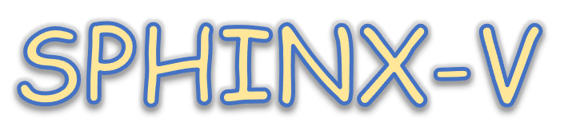
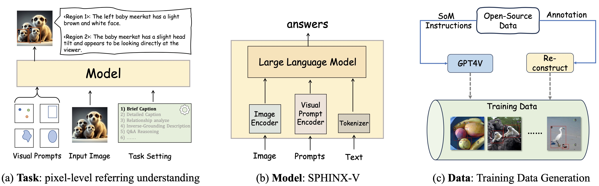
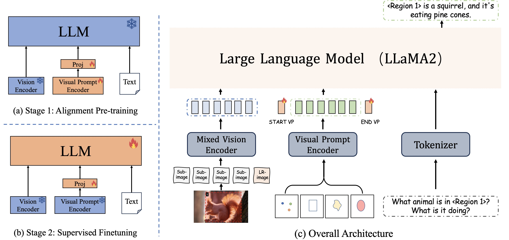
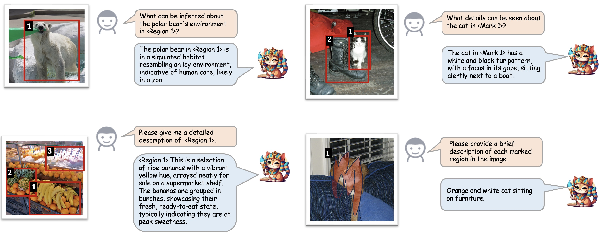
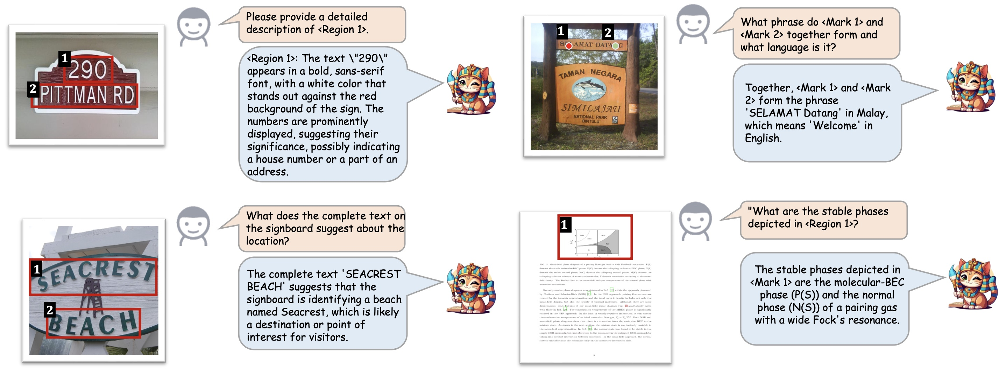
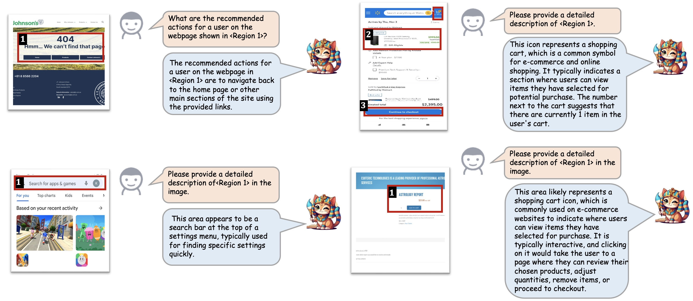
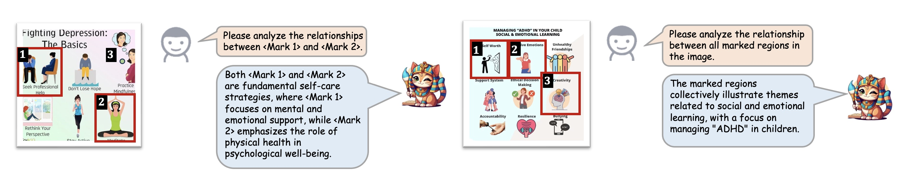
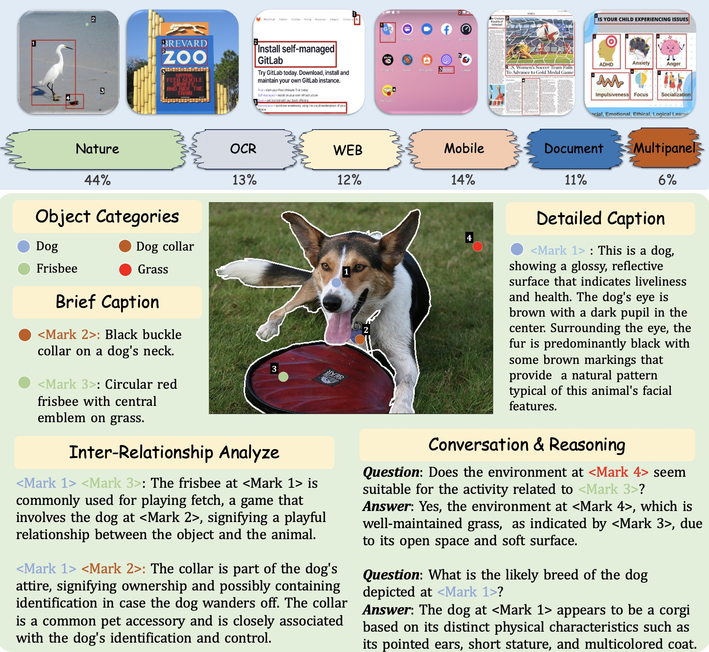

<div align="center">
    
    
</div>


<div align="center">

## 🎨 Draw-and-Understand: Aprovechando Prompts Visuales para Permitir que los MLLMs Comprendan lo que Deseas

[Weifeng Lin](), [Xinyu Wei](), [Ruichuan An](), [Peng Gao]()

[Bocheng Zou](), [Yulin Luo](), [Siyuan Huang](), [Shanghang Zhang]() y [Hongsheng Li]()

</div>

<div align="center">

[](https://draw-and-understand.github.io/) [](https://arxiv.org/abs/2403.20271) [](https://github.com/AFeng-x/Draw-and-Understand/blob/main/LICENSE)

[[🌐 Página del Proyecto](https://draw-and-understand.github.io/)] [[📖 Artículo](https://arxiv.org/abs/2403.20271)] [[🤗 MDVP-Data](https://huggingface.co/datasets/Afeng-x/Draw-and-Understand/tree/main/stage_2_fine-tuning/MDVP-Data)] [[🤗 MDVP-Bench](https://huggingface.co/datasets/Afeng-x/Draw-and-Understand/tree/main/MDVP-bench)] [[🤖️ Modelo](https://huggingface.co/Afeng-x/SPHINX-V-Model)] 

</div>

## 💥 Noticias

- **[2025.06.08]** 🔥🚀 Se ha publicado el Modelo Perceive Anything (PAM). Es un marco conceptualmente simple y eficiente para la comprensión visual exhaustiva a nivel de región en imágenes y videos, permitiendo la segmentación simultánea de objetos con la generación de salidas semánticas diversas y específicas de región, incluyendo categorías, definición de etiquetas, explicaciones funcionales y descripciones detalladas. Consulta el [artículo](https://arxiv.org/abs/2506.05302), el [Sitio Web](https://perceive-anything.github.io/) y el [Código](https://github.com/Perceive-Anything/PAM) para ver las nuevas capacidades y el rendimiento mejorado. Hemos publicado los modelos PAM-1.5b y PAM-3b.

- **[2025.01.23]** 🎉 Draw-and-Understand ha sido aceptado por ICLR 2025

- **[2024.03.28]** 🔥 Hemos publicado el conjunto de datos [MDVP-Data](https://huggingface.co/datasets/Afeng-x/Draw-and-Understand/tree/main/stage_2_fine-tuning/MDVP-Data), el benchmark [MDVP-Bench](https://huggingface.co/datasets/Afeng-x/Draw-and-Understand/tree/main/MDVP-bench) y el [modelo SPHINX-V-13B](https://huggingface.co/Afeng-x/SPHINX-V-Model).

- **[2024.03.28]** 🚀 Publicamos el [artículo en arXiv](https://arxiv.org/abs/2403.20271).

- **[2024.03.28]** 🚀 Publicamos el código de entrenamiento y [evaluación](accessory/eval/readme.md).


<!-- ## 💪 ToDo

- - [x] Coming soon: 

- &nbsp;&nbsp;✅ Coming soon:  -->


## 👀 Introducción

La interacción entre los humanos y la inteligencia artificial (IA) es un factor crucial que refleja la efectividad de los modelos de lenguaje grandes multimodales (MLLM). Sin embargo, los MLLMs actuales se centran principalmente en la comprensión a nivel de imagen y limitan la interacción a instrucciones textuales, restringiendo así su flexibilidad de uso y la profundidad de sus respuestas. Por lo tanto, presentamos el **proyecto Draw-and-Understand**: un nuevo modelo, un conjunto de datos multidisciplinario y un benchmark desafiante para prompts visuales.

<p align="center">
     <br>
</p>

Específicamente, el modelo se denomina **SPHINX-V**, un nuevo modelo de lenguaje grande multimodal diseñado para prompts visuales, equipado con un codificador de prompts visuales novedoso y una estrategia de entrenamiento en dos etapas. SPHINX-V admite múltiples prompts visuales simultáneamente en varios tipos, mejorando significativamente la flexibilidad del usuario y logrando una comprensión de grano fino y de mundo abierto de los prompts visuales.

<p align="center">
     <br>
</p>


## 🚀 Ejemplos

<details>
<summary>🔍 Dominio de Imágenes Naturales</summary>

<p align="center">
     <br>
</p>
</details>

<details>
<summary>🔍 Dominio de Imágenes OCR</summary>

<p align="center">
     <br>
</p>
</details>

<details>
<summary>🔍 Dominio de Capturas de Pantalla de Móvil/Web</summary>

<p align="center">
     <br>
</p>
</details>

<details>
<summary>🔍 Dominio de Imágenes Multipanels</summary>

<p align="center">
     <br>
</p>
</details>


## 🛠️ Instalación 

1. Clona este repositorio y navega a la carpeta Draw-and-Understand
``` bash
git clone https://github.com/AFeng-x/Draw-and-Understand.git
cd Draw-and-Understand
```
2. Instala los paquetes
``` bash
# Crea un nuevo entorno conda llamado 'sphinx-v' con Python 3.10
conda create -n sphinx-v python=3.10 -y
# Activa el entorno 'sphinx-v'
conda activate sphinx-v
# Instala los paquetes requeridos desde 'requirements.txt'
pip install -r requirements.txt
```
3. Opcional: Instalar Flash-Attention
``` bash
# Draw-and-Understand utiliza flash-attention para un cálculo de atención eficiente.
pip install flash-attn --no-build-isolation
```
4. Instala Draw-and-Understand como paquete Python
``` bash
# Ve al directorio raíz de Draw-and-Understand
cd Draw-and-Understand
# Instala Draw-and-Understand
pip install -e .
# Después de esto, podrás ejecutar "import SPHINX_V" sin la restricción del directorio de trabajo.
```
5. Para habilitar la capacidad de segmentación mostrada en nuestra demostración oficial, también se necesita SAM:
``` bash
pip install git+https://github.com/facebookresearch/segment-anything.git
```


## 🤖️ Checkpoints

Pesos de Pre-entrenamiento Etapa 1 de SPHINX-V-13b: 🤗[Hugging Face](https://huggingface.co/Afeng-x/SPHINX-V-Model/tree/main/sphinx-v/stage1) / [Baidu](https://pan.baidu.com/s/1VRSHyKrnyyvdJq-I_r85Vg?pwd=i9f5)

Pesos de Ajuste Fino Etapa 2 de SPHINX-V-13b: 🤗[Hugging Face](https://huggingface.co/Afeng-x/SPHINX-V-Model/tree/main/sphinx-v/stage2) / [Baidu](https://pan.baidu.com/s/1VRSHyKrnyyvdJq-I_r85Vg?pwd=i9f5)

Otros pesos y configuraciones requeridos: 🤗[Hugging Face](https://huggingface.co/Afeng-x/SPHINX-V-Model/tree/main)

Por favor, descárgalos en tu propia máquina. La estructura de archivos debería aparecer de la siguiente manera:
```
accessory/checkpoints/sphinx-v/stage2
├── consolidated.00-of-02.model.pth
├── consolidated.01-of-02.model.pth
├── tokenizer.model
├── config.json
└── meta.json
```
```
accessory/checkpoints/llama-2-13b
├── params.json

accessory/checkpoints/tokenizer
├── tokenizer.model
```


## 📁 MDVP-Dataset

- MDVP-Data es un conjunto de datos integral para el ajuste de instrucciones de prompts visuales en múltiples dominios. Este conjunto de datos abarca datos para comprensión a nivel de punto y región, diseñado para mejorar la capacidad de comprensión y la robustez de un modelo.

- Basado en MDVP-Data, también presentamos MDVP-Bench, un benchmark desafiante diseñado para evaluar tareas que requieren una combinación de referencias de descripción detallada, análisis de relaciones interdependientes y razonamiento complejo.

<p align="center">
     <br>
</p>


## 🚀 Entrenamiento 

- **Preparar datos**
  - Por favor, descarga las anotaciones y las imágenes de nuestros datos de pre-entrenamiento. (Consulta la [Preparación del Conjunto de Datos](Data/dataset.md))

- **Etapa 1: Pre-entrenamiento de Alineación Imagen-Prompt Visual-Texto**
  - Descarga los pesos preentrenados de SPHINX-v2-1k desde [Hugging face](https://huggingface.co/Alpha-VLLM/LLaMA2-Accessory/tree/main/finetune/mm/SPHINX/SPHINX-v2-1k) o [Baidu](https://pan.baidu.com/s/1PKCf515EGmSnSZ8teERHjQ?pwd=88z0)(88z0). Coloca el modelo en el directorio "accessory/checkpoints/sphinx-v2-1k".
  - Descarga el [modelo ViT-H SAM](https://dl.fbaipublicfiles.com/segment_anything/sam_vit_h_4b8939.pth) y colócalo en el directorio "accessory/checkpoints/sam".
  - La configuración de pre-entrenamiento es [vp_pretrain.yaml](./accessory/configs/data/vp_pretrain.yaml). Asegúrate de que se incluyan todas las anotaciones y actualiza las rutas de las imágenes en cada archivo JSON para que reflejen las rutas en tu máquina.
  - Actualiza las rutas del modelo en el script de ejecución.
  - Ejecuta `bash scripts/train_sphinx-v_pretrain_stage1.sh`.

- **Etapa 2: Ajuste Fino Supervisado de Extremo a Extremo para Múltiples Tareas**
  - Descarga los Pesos de Pre-entrenamiento de la Etapa 1 de SPHINX-V desde [🤖️Checkpoints](https://github.com/AFeng-x/Draw-and-Understand?tab=readme-ov-file#%EF%B8%8F-checkpoints). Alternativamente, puedes usar tus propios pesos de modelo entrenados desde la Etapa 1.
  - Coloca el modelo en el directorio "accessory/checkpoints/sphinx-v/stage1".
  - La configuración de ajuste fino es [vp_finetune.yaml](./accessory/configs/data/vp_finetune.yaml). Asegúrate de que se incluyan todas las anotaciones y actualiza las rutas de las imágenes en cada archivo JSON para que reflejen las rutas en tu máquina.
  - Actualiza las rutas del modelo en el script de ejecución.
  - Ejecuta `bash scripts/train_sphinx-v_finetune_stage2.sh`.


## 📈 Evaluación 
Consulta [evaluación](./accessory/eval/readme.md) para más detalles.


## 🛩️ Inferencia
Proporcionamos un ejemplo simple para la inferencia en [inference.py](./SPHINX_V/inference.py)

Puedes ejecutar este script con `torchrun --master_port=1112 --nproc_per_node=1 inference.py`


## 🪁 Ejecutar Demostración Local
💻 **requisitos:** 
1. Para esta demostración, es necesario preparar los checkpoints de la etapa 2 de SPHINX-V y el modelo ViT-H SAM, y colocarlos en el directorio `accessory/checkpoints/`.
2. Asegúrate de haber instalado Segment Anything.
3. Ejecutar.
```
cd accessory/demos
bash run.sh
```


## 💌 Agradecimientos
- [LLaMA-Accessory](https://github.com/Alpha-VLLM/LLaMA2-Accessory): la base de código sobre la cual construimos.
- [SAM](https://github.com/facebookresearch/segment-anything): la demostración también utiliza los resultados de segmentación de SAM.


## 🖊️: Citación

Si encuentras útil nuestro proyecto **Draw-and-Understand** para tu investigación y aplicaciones, por favor cita utilizando este BibTeX:

```latex
@article{lin2024draw,
  title={Draw-and-understand: Leveraging visual prompts to enable mllms to comprehend what you want},
  author={Lin, Weifeng and Wei, Xinyu and An, Ruichuan and Gao, Peng and Zou, Bocheng and Luo, Yulin and Huang, Siyuan and Zhang, Shanghang and Li, Hongsheng},
  journal={arXiv preprint arXiv:2403.20271},
  year={2024}
}
```
